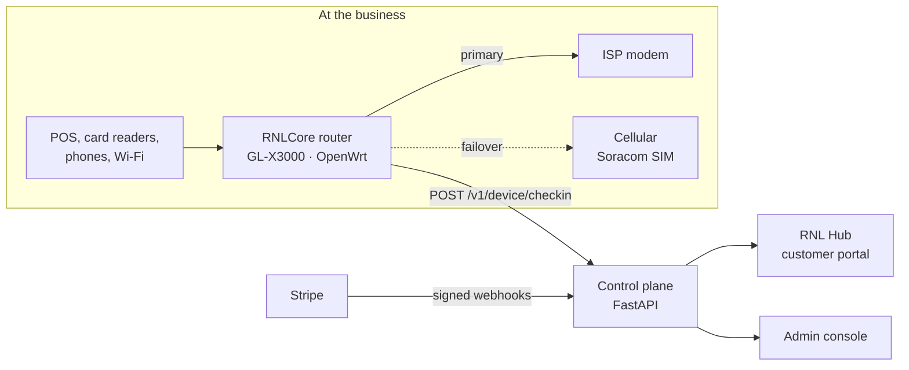
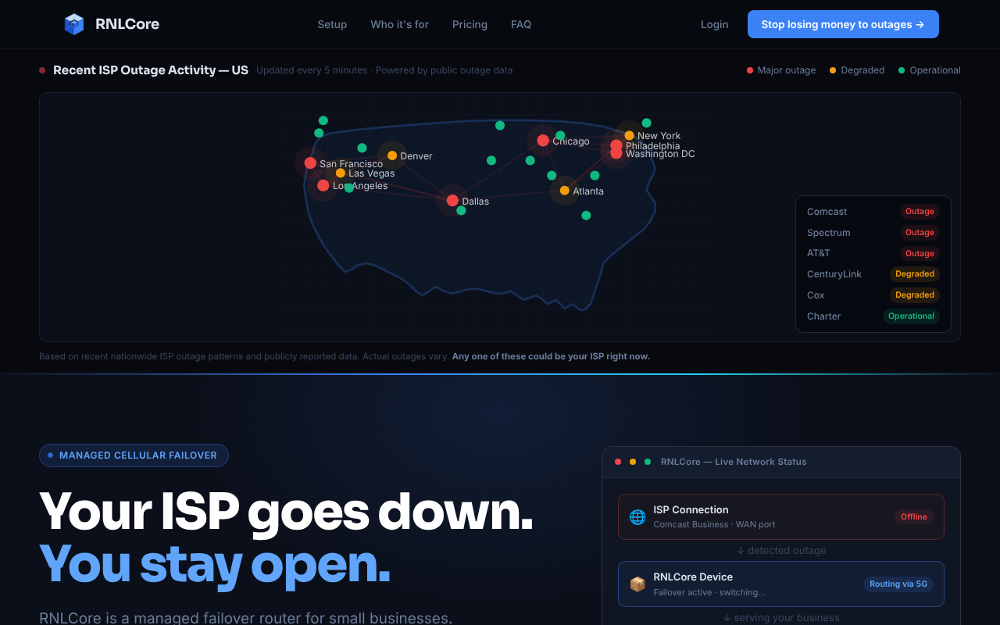
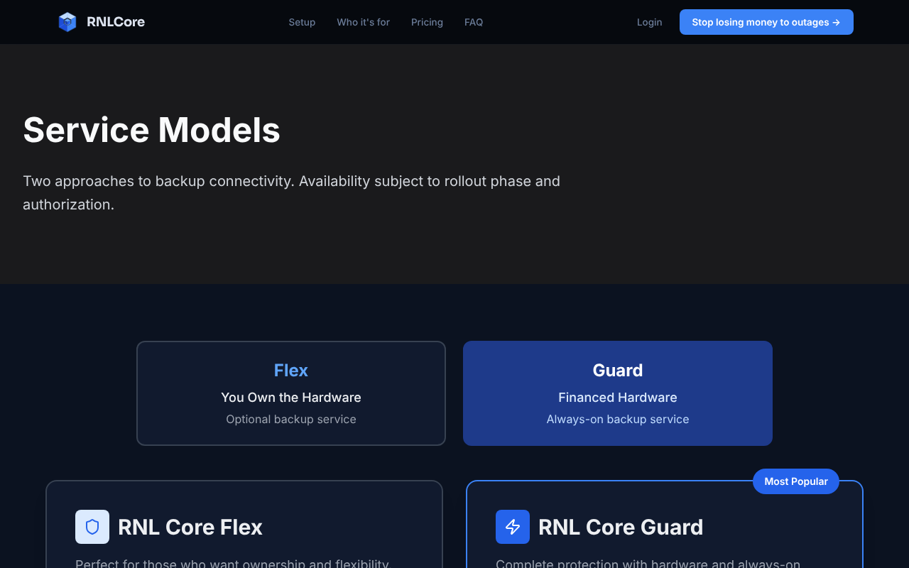
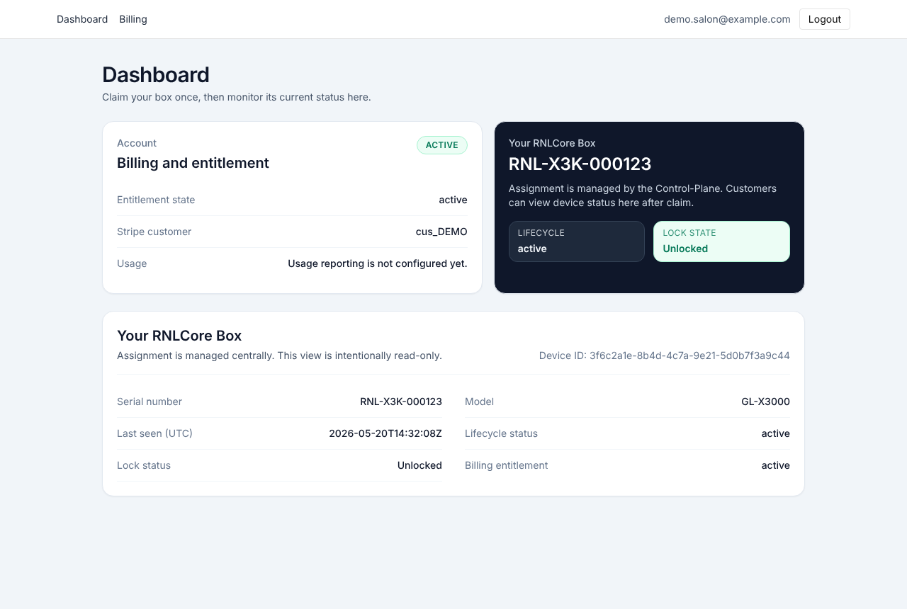
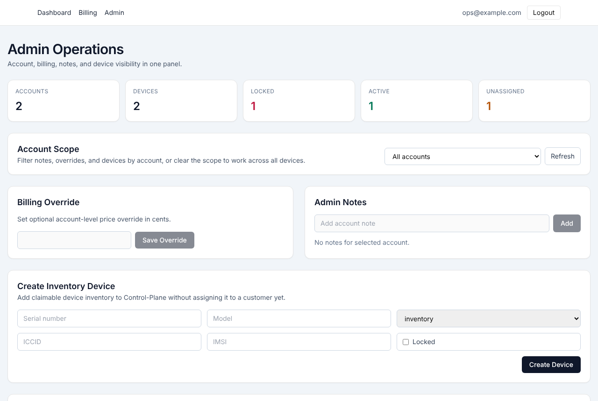
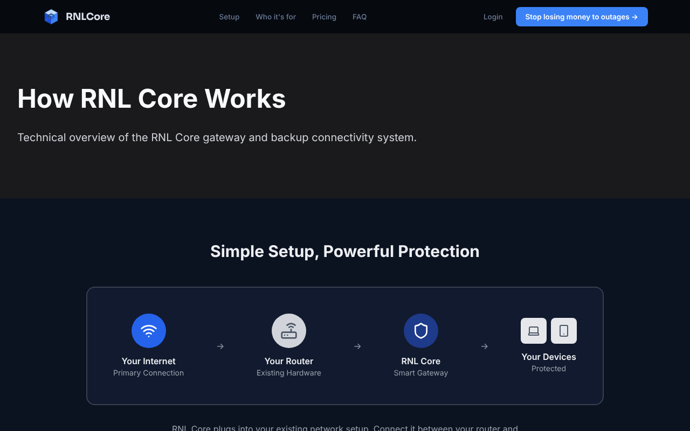
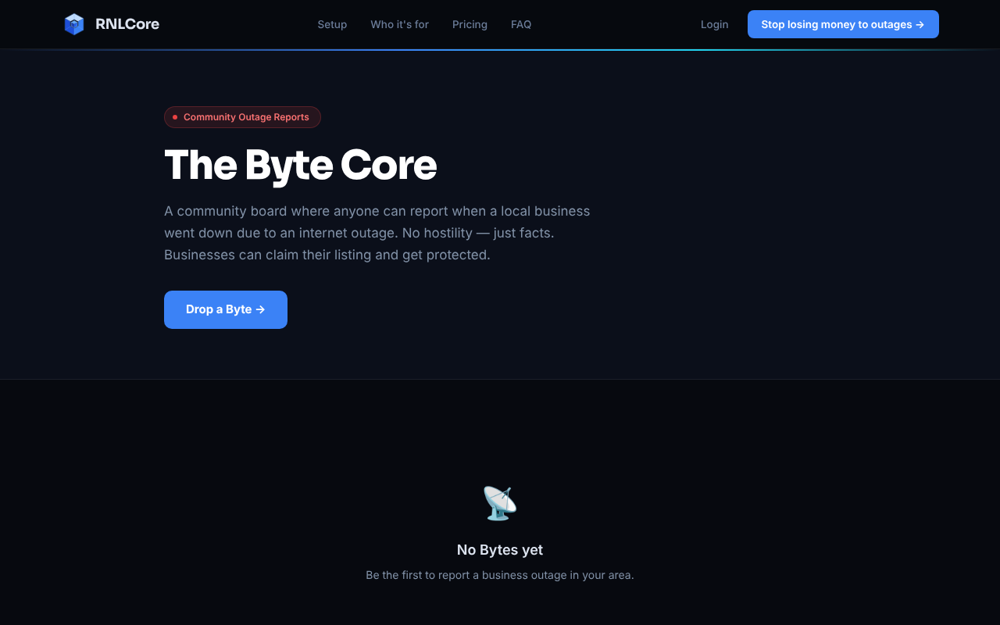

# RNLCore

**Managed cellular failover for small businesses: hardware, firmware, cloud control plane, customer portal and billing, designed and built end to end by one person.**

When a shop's internet drops, card terminals, POS and Wi-Fi keep running on cellular, and nobody has to touch anything. RNLCore was my attempt to give small businesses the kind of failover that enterprise gear (Cradlepoint, Peplink) provides, packaged as a box an owner plugs in, with the service, monitoring and billing managed for them.

> **Status:** Built and bench-tested in 2025–2026. Development is paused. The production source lives in private repositories; this repo is the public overview. I'm happy to walk through the code or demo the failover live.
>
> **Full case study:** [rnlcore-sites.github.io/rnlcore-showcase/case-study](https://rnlcore-sites.github.io/rnlcore-showcase/case-study/)

---

## What I built

| Layer | What it is | Highlights |
|---|---|---|
| **Edge device** | GL.iNet GL-X3000 5G router (Quectel RM520N) running patched OpenWrt | Automatic ISP → cellular failover, iptables service lock, modem self-heal watchdog, repeatable "Golden Base" image |
| **Cellular** | Soracom multi-carrier SIMs | Picks the strongest major network at each site; tuned to idle cheaply |
| **Control plane** | Python / FastAPI, SQLAlchemy, Alembic, pytest | Single source of authority for every device; fail-closed policy on every check-in; billing state drives network access |
| **Customer portal** | RNL Hub, React + Vite + Tailwind | Claim a device by serial, see lock state and entitlement, Stripe checkout |
| **Operations** | Admin console | Inventory, assign/reassign devices, notes, billing overrides, audited actions |
| **Go-to-market** | Marketing site, Byte Core outage board, founder presale | Vertical targeting: auto dealerships, restaurants, salons |

## Architecture

**The rule the whole system is built around:** devices enforce, the control plane decides, the UIs only show state. Nothing on the device or in a browser can grant itself service.

More detail: [docs/architecture.md](docs/architecture.md)

## Engineering highlights

- **Fail-closed by design.** Unknown device, unassigned device, missing account, unknown billing state, server error, or no contact with the control plane all resolve to *locked*. Only an explicit "active" entitlement unlocks service.
- **Billing state = network state.** Stripe webhooks are signature-verified and recorded once per event ID, then mapped through a deterministic entitlement state machine (`active` / `wired_only` / `locked_billing`) into the policy each device receives.
- **Zero-trust provisioning.** Each unit gets a UUIDv4 generated off-device. The device can never create, change or self-register its identity; an admin registers it as locked inventory, and only assignment to an account can unlock it.
- **Cut standby cellular cost ~94%** by tracing idle data burn to the multi-WAN health check pinging every 3 s, and retuning it to 35 s.
- **Cut added latency under load from ~316 ms to ~22 ms** on the cellular path.
- **Root-caused an IPv6 data-call failure** from QMI modem logs (the SIM rejected IPv6 bearers in a 60 s retry loop); fixed by running the cellular interface IPv4-only.

The full list, with what went wrong and how I fixed it: [docs/engineering-log.md](docs/engineering-log.md)

**Read the actual code:** [the policy engine](code/policy_engine.py) (the whole system's decision logic in ~150 lines) and [the Stripe webhook](code/stripe_webhook.py).

## Screenshots

*Portal and admin screenshots use demo data.*

**Marketing site**

**Service models (Flex and Guard)**

**RNL Hub: customer dashboard**

**Admin operations console**

More screenshots

## Source repositories

All private; available for review on request.

| Repo | Contents |
|---|---|
| `Control-Plane` | FastAPI backend: device check-in and policy, auth, customer and admin APIs, Stripe billing, entitlement state machine, audit log, Alembic migrations, pytest suite, CI |
| `Provisioning` | Device identity contract, install scripts, operator docs |
| `rnlhub` | RNL Hub customer portal and admin console (React/Vite) |
| `RNLCore` | Marketing site, Byte Core outage-reporting board |

## Stack

`OpenWrt` `shell` `iptables` `Quectel QMI` `Soracom` `Python` `FastAPI` `SQLAlchemy` `Alembic` `pytest` `Stripe` `React` `Vite` `Tailwind` `GitHub Actions` `nginx`

## About me

**Ryan Donahue** · Hamilton, NJ · ryandonahue61@gmail.com

Self-taught, systems-first builder. Before RNLCore I ran a pool and spa service company, worked as an EMT, and repaired boats and small engines. I'm looking for sales engineering and solutions roles where I can put this kind of hands-on network and product work in front of customers.
