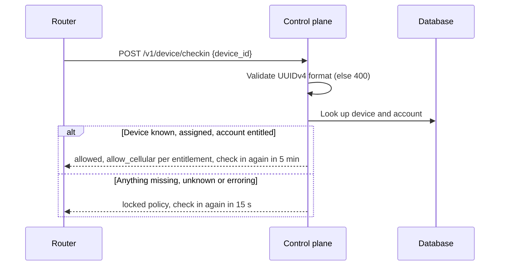
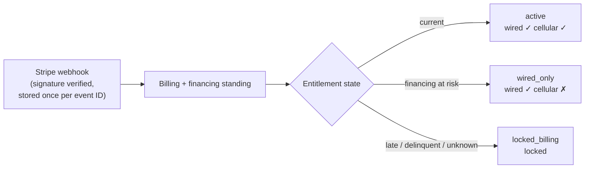
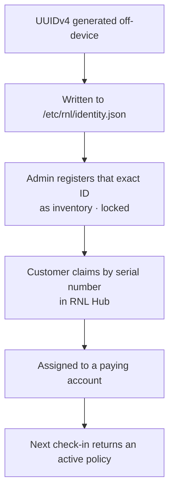

# Architecture

RNLCore has one principle: **devices enforce, the control plane decides, the UIs reflect state.** Every design choice below follows from it.

## 1. Device check-in

Each router periodically calls the control plane with its device ID and gets back a policy it must apply exactly.

### Policy fields returned on every check-in

| Field | Purpose |
|---|---|
| `allowed` | Master allow/deny |
| `allow_wired` / `allow_cellular` | Per-path permission (lets the system gate only the backup path) |
| `captive_portal` | Redirect users to a status page when locked |
| `policy_version` | Versioned contract between device and server |
| `message` | Human-readable reason, surfaced in support tools |
| `checkin_interval_seconds` | Short when locked (fast recovery), long when healthy (low cost) |
| `fail_closed` | Always true: the device must treat silence as "locked" |

### Lock rules

| Situation | Result |
|---|---|
| Device ID unknown | Locked |
| Device unassigned or flagged locked | Locked |
| Account missing | Locked |
| Entitlement state missing or unrecognized | Locked |
| Any exception while evaluating policy | Locked |
| Router can't reach the control plane | Router locks itself |

## 2. Billing → entitlement → enforcement

Billing state never touches devices directly. It goes through one deterministic mapping so there is exactly one source of truth.

The `wired_only` state is the key product decision: a customer with a payment problem loses the paid backup path but never loses their normal internet because of us.

## 3. Provisioning (zero-trust identity)

- The device never generates, edits or self-registers its own ID.
- An installer never overwrites an existing identity file.
- Claims are idempotent; duplicate or already-assigned serials return a controlled conflict instead of a silent overwrite.

## 4. API surface

| Audience | Endpoints |
|---|---|
| Devices | `POST /v1/device/checkin` |
| Customers (RNL Hub) | sign up / log in, account and entitlement, claim device by serial, my devices, usage, Stripe checkout |
| Admins | account list and notes, billing overrides, device inventory (create, register pre-provisioned, edit, delete unassigned), assign / unassign / reassign, time-boxed unlocks, audit log |

## 5. Operations and quality

- Every admin action is written to an immutable audit log; support roles are deliberately limited.
- Schema changes go through Alembic migrations (including moving claim tokens to hashed storage).
- pytest suite covering billing enforcement, claim redemption, device identity, hub device linking and API contracts.
- Validated against a device simulator before hardware integration.
- CI on GitHub Actions.
